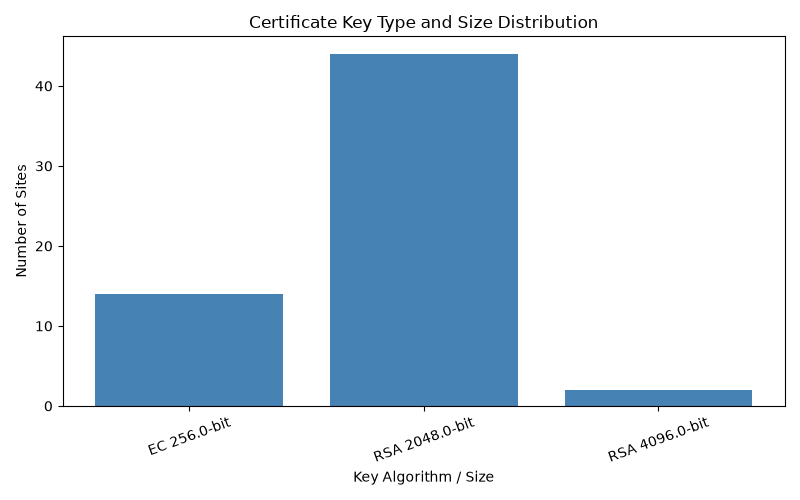
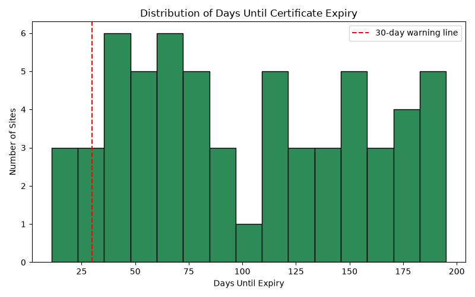

# TLS Certificate Hygiene Study

A small research project testing how well TLS/SSL certificates are maintained across 65 major Indian and global websites — spanning banks, government portals, e-commerce platforms, global tech companies, research institutions, and certificate authorities.

Built after following the October 2026 eMudhra certificate authority incident and the SBI data leak, I wanted to independently check how certificate hygiene (expiry, key strength, chain completeness) actually looks in practice across websites people rely on daily.

**Full write-up with findings and discussion: [REPORT.md](REPORT.md)**

## What I found

- **92% of sites (60/65)** had fully valid, modern certificates — strong key sizes, no outdated algorithms.
- **1 expired certificate**, found on `cowin.gov.in`, India's national COVID-19 vaccination portal, which still holds data for over a billion registered citizens.
- **3 incomplete certificate chains**, at `mpi-inf.mpg.de`, `mpi-sws.org`, and `mpi-sp.org` (Max Planck Institutes), a known TLS misconfiguration category.
- **4 certificates expiring within 30 days** of testing, including one with just 11 days left.

Details, context, and honest limitations are in [REPORT.md](REPORT.md).

## Charts

**Key size and algorithm distribution:**



**Days until certificate expiry (red line = 30-day warning threshold):**



## How it works

1. `collect_certificates.py` connects to each website on port 443, performs a standard TLS handshake (the same thing a browser does when you visit a site), and extracts the certificate's issuer, key type and size, signature algorithm, and validity dates. Results are saved to `certificates.csv`.
2. `analyze_certificates.py` reads that CSV, prints a summary of findings (expiring certificates, weak keys, outdated algorithms, most common issuers), and generates the two charts above.

No site was probed beyond a standard TLS handshake, the same connection any browser makes. No attempt was made to access any system beyond publicly available certificate metadata.

## Running it yourself

**Requirements:** Python 3.8+

```bash
pip install cryptography pandas matplotlib
```

**Collect certificate data:**
```bash
python collect_certificates.py
```
This creates `certificates.csv` in the same folder.

**Analyze and generate charts:**
```bash
python analyze_certificates.py
```
This prints a summary to the terminal and saves `chart_key_sizes.png` and `chart_expiry_distribution.png`.

You can edit the `SITES` list inside `collect_certificates.py` to test a different set of websites.

## Files in this repo

| File | Purpose |
|---|---|
| `collect_certificates.py` | Connects to each site and collects certificate data |
| `analyze_certificates.py` | Analyzes the data and generates charts |
| `certificates.csv` | Raw data collected from all 65 sites |
| `chart_key_sizes.png` | Chart: key algorithm/size distribution |
| `chart_expiry_distribution.png` | Chart: days until expiry across all sites |
| `REPORT.md` | Full write-up: question, method, findings, discussion, limitations |

## Why I built this

I'm a B.Tech CS graduate interested in exploring security and AI research. This project was a way to practice asking a real question, collecting real data carefully, and reporting findings honestly, rather than just building something that works.
